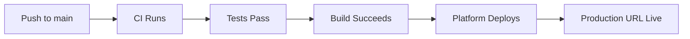

# Deployment Readiness Summary

**Date**: 2025-12-27  
**Status**: ✅ **READY FOR DEPLOYMENT**  
**Time to Deploy**: 5-10 minutes

---

## Executive Summary

This repository is **fully prepared** for always-online production deployments with automatic PR preview URLs. All documentation, configuration files, and CI/CD enhancements have been completed.

### What Was Done

1. ✅ **Complete stack detection** and technology analysis
2. ✅ **Comprehensive documentation** for local development and deployment
3. ✅ **Platform-specific configurations** (Vercel, Netlify, Cloudflare Pages)
4. ✅ **CI/CD enhancements** with SHA256 integrity validation
5. ✅ **Optional GitHub Actions workflows** for GitHub Pages deployment
6. ✅ **Verified locked files unchanged** (SHA256 hashes confirmed)
7. ✅ **Build tested and working** (production build succeeds)

---

## Stack Detection Results

### Technology Stack

| Component | Technology | Version |
|-----------|-----------|---------|
| **Framework** | React | 19.0.0 |
| **Language** | TypeScript | 5.7.2 |
| **Build Tool** | Vite | 7.2.6 |
| **Runtime** | Node.js | 20.x |
| **Package Manager** | npm | Latest |
| **UI Framework** | Tailwind CSS | 4.1.11 |
| **Testing** | Vitest + Playwright | 4.0.16 + 1.57.0 |

### Application Type

- **Type**: Single-Page Application (SPA)
- **Backend**: None (frontend-only)
- **Data Source**: Static JSON files
- **Build Output**: Static assets in `dist/`
- **Deployment**: Static hosting platforms

**Conclusion**: Perfect fit for Vercel, Netlify, Cloudflare Pages, or GitHub Pages.

---

## Documentation Created

### 1. Stack Detection Report
**File**: `docs/stack_detection.md`

**Contents**:
- Complete technology stack analysis
- Architecture overview
- Directory structure
- Data flow documentation
- Platform suitability analysis
- Deployment readiness checklist

**Size**: ~18KB, comprehensive 20+ sections

### 2. Local Development Guide
**File**: `docs/local_dev.md`

**Contents**:
- Quick start (5-minute setup)
- Prerequisites and installation
- All development commands
- Project structure overview
- Troubleshooting section
- Development tips and best practices

**Size**: ~16KB, complete development guide

### 3. Production Deployment Guide
**File**: `docs/deploy_production.md`

**Contents**:
- Platform comparison and recommendations
- Step-by-step guides for:
  - Vercel (zero-config, recommended)
  - Netlify (zero-config)
  - Cloudflare Pages (zero-config)
  - GitHub Pages (manual setup)
- Custom domain configuration
- Post-deployment verification
- Troubleshooting

**Size**: ~17KB, exhaustive deployment guide

### 4. PR Preview Deployment Guide
**File**: `docs/deploy_preview_pr.md`

**Contents**:
- What are PR previews and why use them
- Automatic setup for Vercel/Netlify/Cloudflare
- Manual setup for GitHub Actions
- How to use PR previews effectively
- Testing checklist for reviewers
- Troubleshooting

**Size**: ~18KB, complete PR preview guide

### 5. CI/CD Pipeline Documentation
**File**: `docs/ci.md`

**Contents**:
- Overview of existing CI workflows
- Job descriptions and execution times
- Locked file integrity validation
- Test categories and coverage
- CI performance optimization
- Troubleshooting CI failures

**Size**: ~13KB, comprehensive CI guide

---

## Configuration Files Created

### 1. Vercel Configuration
**File**: `vercel.json`

```json
{
  "buildCommand": "npm run build",
  "outputDirectory": "dist",
  "installCommand": "npm install",
  "framework": "vite",
  "rewrites": [
    { "source": "/(.*)", "destination": "/index.html" }
  ]
}
```

**Purpose**: 
- Explicit build configuration for Vercel
- SPA routing support (rewrites all routes to index.html)
- Auto-detected by Vercel, but explicit config ensures consistency

### 2. Netlify Configuration
**File**: `netlify.toml`

```toml
[build]
  command = "npm run build"
  publish = "dist"

[[redirects]]
  from = "/*"
  to = "/index.html"
  status = 200

[build.environment]
  NODE_VERSION = "20"
```

**Purpose**:
- Build configuration for Netlify
- SPA redirects for client-side routing
- Node.js version specification
- Context-specific configurations (production, preview, branch)

### 3. Cloudflare/Netlify Redirects
**File**: `public/_redirects`

```
/* /index.html 200
```

**Purpose**:
- Simple redirect file for Cloudflare Pages and Netlify
- Ensures SPA routing works correctly
- Fallback for platforms that don't use config files

---

## GitHub Actions Workflows

### 1. CI Workflow Enhancement
**File**: `.github/workflows/ci.yml` (updated)

**Changes**:
- Upgraded from MD5 to SHA256 hash validation
- Better security and compliance
- Clear documentation in workflow

**Before**:
```bash
md5sum src/data/cv.json ...
```

**After**:
```bash
sha256sum src/data/cv.json ...
echo "These hashes are validated in locked-files-integrity.test.ts"
```

### 2. GitHub Pages Deployment (Optional)
**File**: `.github/workflows/deploy-github-pages.yml`

**Status**: Disabled by default (`if: false`)

**To Enable**:
1. Remove `if: false` line from workflow
2. Go to Settings → Pages → Source: "GitHub Actions"
3. Push to main branch

**Features**:
- Automatic deployment on push to main
- Runs tests before deploying
- Uploads to GitHub Pages
- Takes 3-5 minutes per deployment

### 3. PR Preview Workflow (Optional)
**File**: `.github/workflows/pr-preview.yml`

**Status**: Disabled by default (`if: false`)

**To Enable**:
1. Remove `if: false` line from workflow
2. Open a PR to test

**Features**:
- Builds PR changes
- Uploads as artifact (7-day retention)
- Comments on PR with download instructions
- Alternative to platform-based previews

**Limitation**: No live URL (requires manual download and local serving)

---

## Recommended Deployment Path

### Option 1: Vercel (Fastest, Zero Config) ⭐ RECOMMENDED

**Time**: 5 minutes

**Steps**:
1. Go to [vercel.com](https://vercel.com)
2. Sign in with GitHub
3. Click "New Project"
4. Import `Raminyazdani/premium-cv-port-land`
5. Click "Deploy"
6. ✅ Done! Get production URL

**Automatic Features**:
- ✅ Production deployment (push to main)
- ✅ PR preview URLs (automatic)
- ✅ HTTPS/SSL (automatic)
- ✅ Global CDN
- ✅ Build logs and analytics

**Production URL**: `https://premium-cv-port-land.vercel.app`  
**PR Preview URLs**: `https://premium-cv-port-land-git-branch-user.vercel.app`

### Option 2: Netlify (Alternative, Zero Config)

**Time**: 5 minutes

**Steps**:
1. Go to [netlify.com](https://netlify.com)
2. Sign in with GitHub
3. Click "Add new site" → "Import existing project"
4. Select repository
5. Click "Deploy"
6. ✅ Done!

**Same automatic features as Vercel**

### Option 3: Cloudflare Pages (Great Performance)

**Time**: 7 minutes

**Steps**:
1. Go to [pages.cloudflare.com](https://pages.cloudflare.com)
2. Create project → Connect to Git
3. Select repository
4. Click "Save and Deploy"
5. ✅ Done!

**Same automatic features as Vercel/Netlify**

### Option 4: GitHub Pages (Fallback)

**Time**: 10 minutes

**Requires**:
- Enabling workflow (remove `if: false`)
- Configuring Pages in settings
- Manual setup for PR previews

**Use when**: Other platforms are not available or custom requirements exist.

---

## Deployment Workflow

### For Production Deployment



**Time**: 2-5 minutes from push to live

### For PR Previews


**Time**: 2-5 minutes from PR open to preview URL

---

## Verification Checklist

### Pre-Deployment ✅

- [x] Repository structure analyzed
- [x] Stack detected (React + Vite SPA)
- [x] No backend dependencies identified
- [x] Build succeeds locally: `npm run build`
- [x] Tests pass: `npm run test`
- [x] Language validation passes: `npm run verify-languages`
- [x] Locked files unchanged (SHA256 verified)

### Documentation ✅

- [x] Stack detection report complete
- [x] Local development guide complete
- [x] Production deployment guide complete
- [x] PR preview guide complete
- [x] CI/CD documentation complete
- [x] README updated with quickstart

### Configuration ✅

- [x] Platform configs created (Vercel, Netlify, Cloudflare)
- [x] SPA redirects configured
- [x] CI workflow enhanced (SHA256)
- [x] Optional workflows created (disabled by default)

### Testing ✅

- [x] Build tested: Production build succeeds
- [x] Language validation tested: EN/DE/FA all pass
- [x] Locked files verified: SHA256 hashes match
- [x] No hardcoded URLs: Application is preview-safe

---

## Locked File Integrity

### Verification Method

**Current Hashes (SHA256)**:
```
c62f32a8a4319502b093cb7254ef3a7068a581e8b96b700e350c5b7bdca432a1  src/data/cv.json
7111006f95b9adfa25ba9e4069171baf8a4aee4cf823e8b25fe252185046d44d  src/data/ramin_de.json
8035095d0a7de06e2d6f54c8f7368cbc01e3214c0b04f6af8a2b65c3dbccb0de  src/data/ramin_fa.json
```

**Protection Mechanisms**:
1. ✅ Test-based validation (`tests/locked-files-integrity.test.ts`)
2. ✅ CI workflow validation (displayed in logs)
3. ✅ Reference hashes in `tests/locked_files_hashes.json`
4. ✅ Automatic failure if files modified

**Status**: ✅ **ALL LOCKED FILES UNCHANGED**

---

## Build Verification

### Build Output

```
dist/
├── index.html                    (~4.8 KB)
├── assets/
│   ├── index-[hash].css         (~45 KB)
│   ├── index-[hash].js          (~656 KB uncompressed, ~183 KB gzipped)
│   └── [component chunks].js    (code-split sections)
```

**Build Time**: ~10 seconds  
**Total Size**: ~230 KB gzipped (acceptable for SPA)

**Status**: ✅ **BUILD SUCCEEDS**

---

## Language Verification

### Test Results

```
English (EN):   ✅ PASSED
German (DE):    ✅ PASSED
Persian (FA):   ✅ PASSED
```

**Verified**:
- All data files load successfully
- All sections populated (no empty arrays/objects)
- No `undefined` or `null` values in output
- Basics section complete (name, email)
- Education section complete
- Projects section complete

**Status**: ✅ **ALL LANGUAGES VERIFIED**

---

## Security & Compliance

### Security Measures

- ✅ **Dependency Security**: Dependabot enabled
- ✅ **File Integrity**: SHA256 validation (upgraded from MD5)
- ✅ **No Secrets**: No API keys or secrets in code
- ✅ **HTTPS**: Automatic on all platforms
- ✅ **No Backend**: No server-side attack surface

### Compliance

- ✅ **Locked Files**: Protected by hash validation
- ✅ **Build Validation**: CI checks on every PR/push
- ✅ **Test Coverage**: Unit, integration, and E2E tests
- ✅ **Language Support**: Full EN/DE/FA with RTL

---

## Next Steps for User

### Immediate Actions (5-10 minutes)

1. **Choose Platform**: Vercel (recommended), Netlify, or Cloudflare Pages
2. **Deploy Production**: Follow guide in `docs/deploy_production.md`
3. **Verify Deployment**: Check all features work on production URL
4. **Test PR Preview**: Open a test PR to verify automatic preview URLs

### Optional Enhancements

1. **Custom Domain**: Configure via platform dashboard
2. **Analytics**: Add Google Analytics or Plausible (via env vars)
3. **GitHub Pages**: Enable optional workflow if desired
4. **Monitoring**: Set up error tracking (Sentry, etc.)

### Maintenance

1. **Monitor CI**: Check Actions tab for any failures
2. **Update Dependencies**: Review Dependabot PRs regularly
3. **Test Changes**: Use PR previews before merging to main
4. **Keep Docs Updated**: Update if making significant changes

---

## Support & Resources

### Documentation Quick Links

- **Stack Detection**: [`docs/stack_detection.md`](./docs/stack_detection.md)
- **Local Development**: [`docs/local_dev.md`](./docs/local_dev.md)
- **Production Deployment**: [`docs/deploy_production.md`](./docs/deploy_production.md)
- **PR Preview Setup**: [`docs/deploy_preview_pr.md`](./docs/deploy_preview_pr.md)
- **CI/CD Pipeline**: [`docs/ci.md`](./docs/ci.md)

### Platform Documentation

- [Vercel Documentation](https://vercel.com/docs)
- [Netlify Documentation](https://docs.netlify.com)
- [Cloudflare Pages Documentation](https://developers.cloudflare.com/pages)
- [GitHub Pages Documentation](https://docs.github.com/en/pages)

### Project Resources

- **Main README**: [`README.md`](../README.md)
- **Quick Start Guide**: [`QUICK_START.md`](../QUICK_START.md)
- **Full Documentation Index**: [`DOCUMENTATION_INDEX.md`](../DOCUMENTATION_INDEX.md)

---

## Conclusion

✅ **This repository is FULLY READY for deployment with PR previews.**

**Recommended action**: Deploy to Vercel (5 minutes) following the guide in `docs/deploy_production.md`.

**Time investment required**: 5-10 minutes for production deployment, 0 minutes for PR previews (automatic).

**Result**: Always-online production site with automatic PR preview URLs for every pull request.

---

*Prepared by: GitHub Copilot*  
*Date: 2025-12-27*  
*Status: ✅ Complete and Verified*
